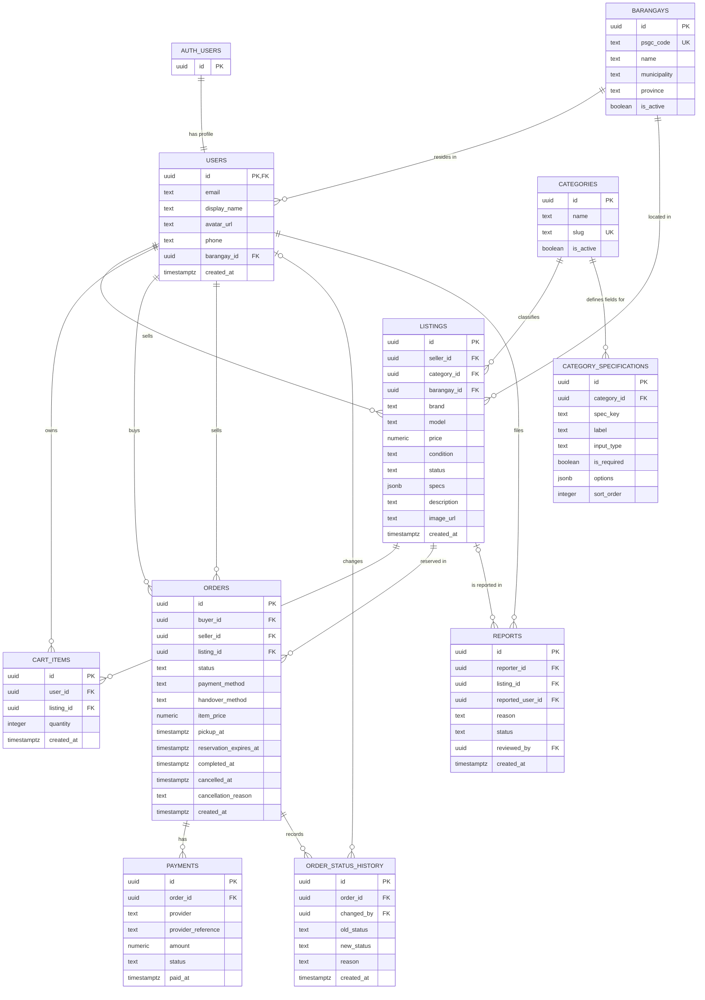

# ByteSaver Database Schema and ERD

> October 19, 2026: ID submission, private document storage, and administrator review have been implemented separately. See [the current identity schema and access rules](identity-verification.md). This older ERD omits those additions; its phone/barangay-only onboarding description is superseded. Orders and payments below remain a target design.

**Status:** Target MVP schema and migration plan  
**Database:** Supabase PostgreSQL  
**Currency:** PHP (prices stored as decimal pesos)

This target extends the current Supabase schema shown in `ByteSaver Isabel Marketplace ERD (1).png`. It preserves the existing `users`, `listings`, and `cart_items` records and adds required profile setup, listing locations, and reservation/transaction entities. Phone numbers are required profile contact information but are not OTP-verified. The first implementation step adds profile onboarding; it does not yet implement the whole ERD.

## Current database baseline

The SQL files in `supabase/migrations/` are incremental changes to an existing Supabase project, not a complete database bootstrap. They assume the baseline tables below already exist. The existing auth signup trigger must create the matching profile row, and listing uploads require the `listing-images` storage bucket and its access policies. See the root README for local setup.

The app implements authentication, required phone/barangay profile setup, browsing/details, listing creation with category-defined specifications, and a saved cart. The transaction, payment, reporting, and moderation rules below describe the target system; their presence in this document does not mean they are implemented or enforced by the current app/database migrations.

- `users`: `id` (UUID PK and FK to `auth.users.id`), `email`, `display_name`, `avatar_url`, `created_at`.
- `listings`: `id`, `seller_id`, `brand`, `model`, `category` (text), `price`, `condition`, `status`, `specs`, `description`, `created_at`, `image_url`.
- `cart_items`: `id`, `user_id`, `listing_id`, `quantity`, `created_at`.

The current app reads and updates profiles by `users.id`; signup submits `display_name` in auth metadata. Earlier profile-sync code used `users.user_id` and `users.full_name`. Keep the existing database's `id` and `display_name` names when reconciling older deployments.

## Target ERD

`AUTH_USERS` represents Supabase's managed `auth.users`; do not create it in `public`.

## Target table rules

- **Users and profile completion:** `users.id` remains the UUID primary key/FK to `auth.users.id`. The app requires a nonblank `phone` and a selected `barangay_id` before marketplace access. The phone is contact information only; ByteSaver does not confirm ownership with OTP. `barangay_id` references a predefined Isabel barangay. Phone and email are private profile details and must not be included in public listing queries.
- **Barangays:** Seed the 24 barangays in Isabel, Leyte from the PSA Philippine Standard Geographic Code (PSGC) list. Store the official PSGC code as a unique stable key; `name`, `municipality`, and `province` together are also unique. Do not make `users.barangay_id` non-null until the list has been seeded and existing users have completed onboarding.
- **Categories and listing specifications:** Categories use stable UUID IDs and unique slugs. `category_specifications` defines which fields the sell form displays for each category, including the field key, label, input type, whether it is required, optional select choices, and display order. The React sell form reads these definitions from Supabase. Listing-specific answers remain in `listings.specs` as JSONB, keyed by each definition's `spec_key` (for example, `{"socket":"AM4","cores":6}`). This keeps category field setup editable without adding a new SQL column for every hardware attribute. Listings reference `categories.id` and `barangays.id`; condition is constrained to `Like new`, `Excellent`, `Good`, or `Fair`; price must be greater than zero. New listings start `pending`; only `approved` listings appear in normal browsing. Store moderation actor/time fields if admin moderation is enabled.
- **Cart:** `cart_items` remains a persistent saved cart with `UNIQUE (user_id, listing_id)` and quantity at least one. It is not an order. Reject adding one's own listing or a listing that is not approved.
- **Orders:** An order reserves one listing, references both buyer and seller profiles, and snapshots the agreed `item_price`. A listing can have at most one active order at a time. Suggested statuses are `pending`, `accepted`, `completed`, `cancelled`, and `expired`. Set a reservation expiry and restore the listing to available if the reservation expires or is cancelled. Keep the phone number on the profile; reveal it only to the other party after acceptance. The order does not need a phone column unless ByteSaver specifically needs an immutable contact snapshot.
- **Payments:** Store payment method/status and any payment-provider reference. If buyer and seller pay each other directly at handover, ByteSaver records their reported payment state; it does not claim to process or hold funds. Provider references are nullable for cash or off-platform payments.
- **Order status history:** Append a row for each status transition with actor, previous/new status, reason, and timestamp. Clients must not be able to forge admin actions or write arbitrary status transitions.
- **Reports:** Users can report a listing or account (at least one target is required); admins review them. This supports the moderation scope in the product brief.
- **Security:** Enable RLS on all public tables. Enforce ownership and role checks in policies or trusted server-side functions. Users must not be able to set their own admin role, phone verification timestamp, payment outcome, or moderation fields. Do not expose phone numbers to anonymous marketplace reads.

## Safe migration sequence

1. Add `barangays.psgc_code` as a unique column, then seed Isabel, Leyte's 24 PSA-listed barangays. Preserve PSGC codes as identifiers if names are corrected later.
2. Add nullable `users.phone` and `users.barangay_id`; preserve existing IDs and profile fields. Resolve the app's `user_id`/`full_name` versus `id`/`display_name` mismatch; the signup trigger already writes `id` and `display_name`.
3. Create `categories` and `category_specifications`, seed the initial category and field definitions, add nullable `listings.category_id`, and backfill it by matching each current `listings.category` value. The sell form reads category and field definitions from these tables and writes answers into `listings.specs`. Verify that listings have been backfilled before making `category_id` required. Keep the legacy text column until all clients have moved to `category_id`.
4. Add listing moderation fields/defaults and policies. Backfill existing listings to the appropriate status before filtering normal marketplace reads to `approved`.
5. Add order, payment, status-history, and report tables only when the corresponding transaction and admin flows are ready. Add uniqueness/locking rules so one listing cannot be reserved by two active orders.
6. Deploy the profile-completion gate: on session load, require a nonblank phone number and selected barangay; route incomplete users to Manage Profile and block marketplace access until both are present. Phone ownership is not verified with OTP. Keep sign-out available there. After existing accounts complete setup, make `users.barangay_id` non-null if every account must have a location.

The schema diagram alone does not implement these policies or application flows. Codex prepared the first profile-onboarding migration locally, but it has not been run against the live Supabase project.
